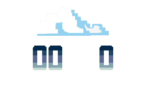

# Bem-vindo a Toolbox Tech Playground☁️!

### Cloud, SRE e DevOps sem enrolação. Do zero ao primeiro emprego em tech.

Você já travou num `git rebase`, apanhou do Kubernetes às 2h da manhã ou ficou em dúvida sobre como começar na área? A gente também. Por isso a Toolbox Tech existe: **tornar a tecnologia mais acessível a pessoas e empresas, com consultoria e educação em Cloud, SRE e DevOps.**

Aqui no Playground você encontra a prática da rotina real, sem teoria solta.

## 🚀 Quer aprender de verdade? Comece pelo treinamento
Cursos objetivos, com trilha clara e foco em colocar você no mercado.

👉 **[Acesse o site de treinamentos e dê o primeiro passo](https://tbxtech.com.br/?utm_source=github&utm_medium=readme&utm_campaign=playground&utm_content=cta_principal)**

## 🛠️ O que você encontrará aqui
- Exemplos práticos da rotina de um DevOps/SRE.
- Códigos prontos para usar e adaptar.
- Boas práticas de Git, bancos de dados (Redis, SQL), Kubernetes e resposta a incidentes.

Quer ver isso em formato de vídeo, dica rápida ou guia passo a passo? Siga a gente no [Instagram](https://www.instagram.com/tbx.tech/) e no [YouTube](https://www.youtube.com/channel/UCZ_qBxHKlo2dooxMEg2tmGA).

## 🏆 Apoio à comunidade
Patrocinadora Oficial do **DevOpsDays Campinas 2025** e da **Campus Party 2025 Distrito Federal**.

## 🤝 Como colaborar
Nós ❤️ contribuições open-source! Seja corrigindo um bug, melhorando a documentação ou sugerindo uma nova funcionalidade:
1. Faça um fork do repositório.
2. Crie uma branch.
3. Faça suas alterações.
4. Envie um pull request.

## 📬 Entre em contato
- 🎓 [Treinamentos e site oficial](https://tbxtech.com.br/?utm_source=github&utm_medium=readme&utm_campaign=playground&utm_content=contato)
- ✍️ [Blog](https://blog.tbxtech.com.br/)
- 📷 [Instagram](https://www.instagram.com/tbx.tech/)
- ▶️ [YouTube](https://www.youtube.com/channel/UCZ_qBxHKlo2dooxMEg2tmGA)
- 💬 [WhatsApp](https://api.whatsapp.com/send/?phone=5519983430011)
- 📧 contato@tbxtech.com
- 🐦 [Twitter / X](https://x.com/toolboxtech_)

---
**Pronto para sair do tutorial e entrar no mercado?** [Conheça os treinamentos da TBX →](https://tbxtech.com.br/?utm_source=github&utm_medium=readme&utm_campaign=playground&utm_content=rodape)
